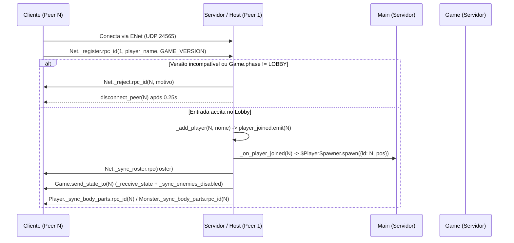
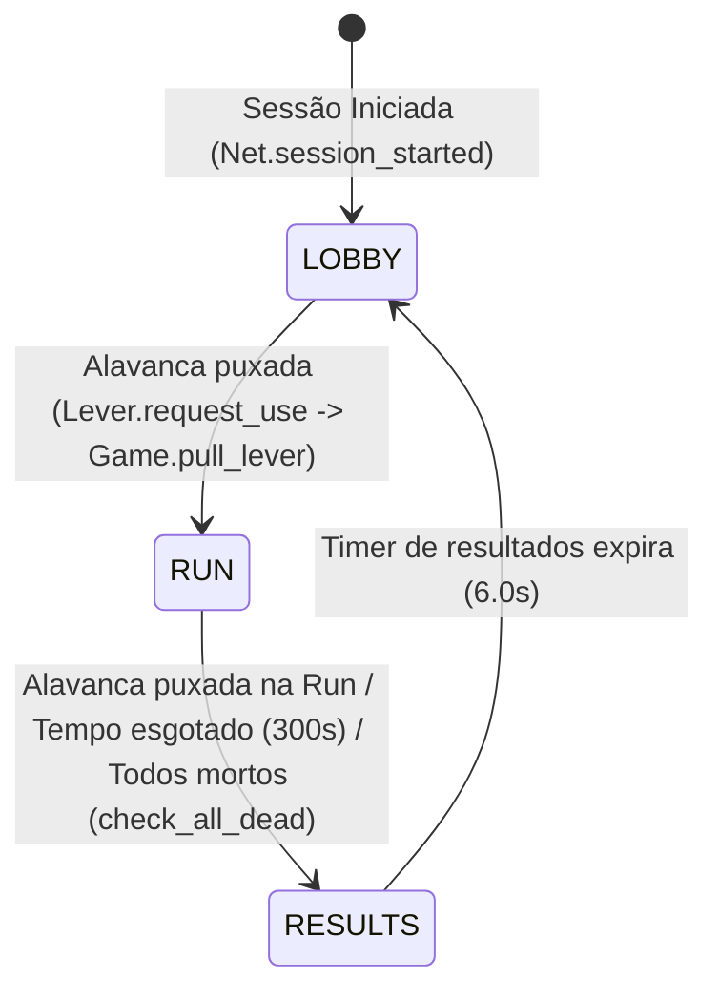
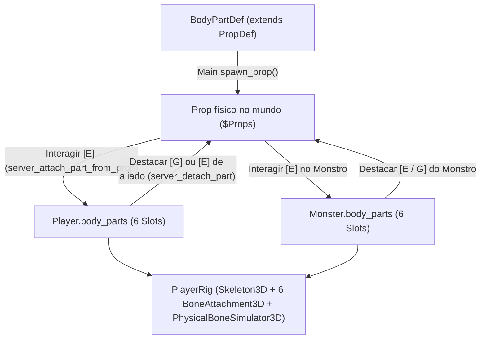
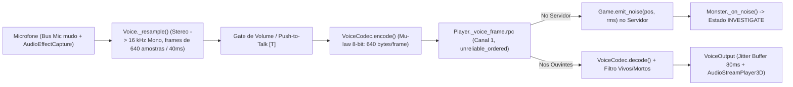

# Arquitetura dos Subsistemas — Capybara Punk

Este documento apresenta a arquitetura detalhada dos subsistemas do projeto **Capybara Punk**, incluindo diagramas de fluxo, autoridade de rede, máquina de estados da partida, pipeline de voz 3D, física cooperativa e sistema corporal modular.

Para consultar os detalhes de cada arquivo individualmente, veja [`docs/catalogo-arquivos.md`](catalogo-arquivos.md). Para diretrizes rápidas de IA, veja [`../AGENTS.md`](../AGENTS.md).

---

## 1. Visão Geral da Árvore de Cena Única (`scenes/main.tscn`)

Toda a execução do jogo ocorre em uma única cena raiz (`Main`), evitando invalidação de caminhos de nós (`NodePath`) durante chamadas RPC e replicação via `MultiplayerSpawner`.

```mermaid
flowchart TD
    subgraph Root [SceneTree Root]
        S["Autoload: Settings"]
        N["Autoload: Net"]
        G["Autoload: Game"]
        V["Autoload: Voice"]
        M["Main (scenes/main.tscn)"]
    end

    subgraph World3D [Mundo 3D em Main]
        WE["WorldEnvironment + MenuCamera"]
        LVL["Level (LevelGenerator / NavigationRegion3D)"]
        VAN["Van (CSG + Gate + Lever + ExtractionZone + SpawnPoints)"]
        WFX["WeaponFx (Traçantes e Explosões)"]
    end

    subgraph Containers [Containers Dinâmicos + Spawners]
        PS["PlayerSpawner --> Players"]
        PRS["PropSpawner --> Props"]
        MS["MonsterSpawner --> Monsters"]
        IS["ItemSpawner --> Items"]
        DS["DroneSpawner --> Drones"]
    end

    subgraph UILayer [CanvasLayer: UI]
        MM["MainMenu"]
        HUD["HUD (5 Slots + Modal Corporal + CarryPanel)"]
        PM["PauseMenu"]
    end

    M --> WE
    M --> LVL
    M --> VAN
    M --> WFX
    M --> PS
    M --> PRS
    M --> MS
    M --> IS
    M --> DS
    M --> MM
    M --> HUD
    M --> PM
```



---

## 2. Fluxo de Sessão de Rede e Handshake (`Net`)

O singleton `Net` (`scripts/autoload/net.gd`) encapsula o `ENetMultiplayerPeer` na porta UDP `24565` para até 8 jogadores.

- **Validação de Entrada**: Clientes só podem entrar se `version == Net.GAME_VERSION` (`"0.1.0"`) e se a partida estiver na fase `Game.Phase.LOBBY`. Caso contrário, o servidor envia `_reject.rpc_id(sender, refusal)` e desconecta o peer após `0.25s`.
- **Sincronização Inicial**: Quando aceito, o servidor adiciona o jogador ao `roster` (atribuindo uma cor da `PALETTE`), emite `player_joined(peer_id)` (que faz `Main` instanciar o `Player` via `PlayerSpawner`), transmite `_sync_roster.rpc(roster)` para todos e envia o estado atual da partida via `Game.send_state_to(sender)`.
- **Sincronização Tardia de Membros**: Tanto `Player` quanto `Monster` escutam `Net.player_joined` no servidor e enviam `_sync_body_parts.rpc_id(joined_peer_id, body_parts)` para garantir que quem acabou de entrar veja os membros corretos.



---

## 3. Máquina de Estados da Partida e Ciclo de Run (`Game` + `Main`)

O singleton `Game` (`scripts/autoload/game.gd`) controla as 3 fases da partida no servidor e replica o estado a cada `1.0s` (ou imediatamente em transições) via `_receive_state.rpc`:



### O que acontece em cada transição:

1. **Entrada no `LOBBY`**:
   - Portão do van (`$Van/Gate`) fica fechado (`use_collision = true`, `visible = true`).
   - No início da sessão ou no fim de uma run, o servidor gera os `lobby_items` enfileirados em `$Van/LobbyItemSpot` (Revólver, Munição, Cacetete, Granada).
2. **Transição `LOBBY -> RUN` (`Game.pull_lever()`)**:
   - Servidor sorteia `level_seed = randi()`, zera `collected`, define `time_left = 300.0` e chama `_begin_run.rpc(level_seed)`.
   - **Em todos os peers**: `Main._on_run_started(level_seed)` abre o portão da van e chama `level.generate(level_seed)`. Como o `RandomNumberGenerator` recebe a mesma `level_seed` e percorre a mesma grade (`columns = 5`, `rows = 4`), todos constroem exatamente a mesma geometria de salas, portas, pilares e luzes (`layout_signature` idêntica).
   - **Apenas no servidor**: `LevelGenerator` assa o `NavigationMesh` em runtime (`bake_navigation_mesh(true)`) e emite `navigation_ready`. Em seguida, `Main` sorteia e instancia:
     - `Prop` de loot em `level.prop_spots` usando `loot_table` (Caixas, Vasos, Racks de Servidor, Braço Hidráulico, Perna Booster).
     - `WorldItem` em `level.item_spots` usando `item_table`.
     - `Monster` em `level.monster_spot` (célula mais profunda do labirinto) e `Drone` com circuitos de 4 salas em `level.patrol_spots` (se `not Game.enemies_disabled`).
3. **Durante a `RUN`**:
   - `ExtractionZone` (`Area3D` no piso da van) soma o `net_value` de todos os `Prop` dentro da área a cada `0.25s` no servidor e chama `Game.set_collected(total)`.
4. **Transição `RUN -> RESULTS` (`Game.end_run()`)**:
   - Avalia `success = collected >= quota`.
   - Se `success == true`: `day += 1` e `quota = ceili(quota * 1.35)`.
   - Se `success == false`: `day = 1` e `quota = 300` (`BASE_QUOTA`).
   - Emite `_finish_run.rpc(success, collected_now, quota_now)`.
   - `Main._on_run_ended` fecha o portão da van, limpa a geometria do `LevelGenerator`, remove todos os `props`, `monsters`, `items` e `drones`, recria os `lobby_items`, e chama `player.server_revive(spawn_point)` para todos os jogadores (restaurando 100 HP, membros orgânicos faltantes e limpando o inventário de volta para apenas a Lanterna no slot 1).

---

## 4. Modelo Híbrido de Autoridade e Física Cooperativa

### 4.1. Divisão Cliente vs Servidor

| Aspecto | Autoridade | Mecanismo de Sincronização |
| :--- | :--- | :--- |
| Posição, rotação, agachamento, corrida do `Player` | Cliente Dono (`peer_id`) | `MultiplayerSynchronizer` a `20 Hz` (`net_position`, `net_yaw`, `net_pitch`, `net_crouching`, `net_sprinting`) |
| Recuo de armas e impulso de knockback no `Player` | Cliente Dono (`peer_id`) | Calculado localmente no tiro (`apply_recoil`) ou enviado pelo servidor via `Player._receive_knock.rpc_id(peer_id)` |
| Vida (`health`), morte (`alive`) e membros (`body_parts`) | Servidor (`1`) | RPCs `_sync_vitals.rpc` e `_sync_body_parts.rpc` |
| Inventário de 5 slots (`Loadout`) e disparo real | Servidor (`1`) | Cliente prevê gasto/drop localmente; servidor valida e envia `_sync_state.rpc_id(peer_id)` |
| Física de `Prop` e `WorldItem` (`RigidBody3D`) | Servidor (`1`) | Simulados apenas no servidor; clientes usam `FREEZE_MODE_KINEMATIC` e interpolam `net_position` / `net_rotation` |
| IA de `Monster` e `Drone` (`CharacterBody3D`) | Servidor (`1`) | Simulados no servidor com `NavigationServer3D`; clientes interpolam `net_position` / `net_yaw` |

### 4.2. Física de Carga Cooperativa (`Prop`)

```mermaid
flowchart LR
    subgraph ClientSide [Cliente Dono]
        P["Player.try_grab(prop)"]
        HT["get_hold_target() (Head + Aim * net_hold_distance)"]
    end

    subgraph ServerSide [Servidor (Prop._physics_process)]
        RG["Prop.request_grab()"]
        H["holders[peer_id] = player"]
        AF["_apply_holders()"]
        F["Força Mola-Amortecedor limitada por player.get_grip_force()"]
        IMP["_on_body_entered() -> Reduz net_value + Emite Barulho"]
    end

    P -->|"RPC id 1"| RG
    RG --> H
    H --> AF
    HT -.->|"net_pitch / net_yaw / net_hold_distance"| AF
    AF --> F
    F --> IMP
```

- Cada jogador possui força de pegada dada pela soma de `grip_force` dos seus braços instalados:
  - 2 braços orgânicos (`175 N` cada) = **`350 N`** (~`35.7 kg` na gravidade de `9.8 m/s²`).
  - 1 braço hidráulico (`280 N`) + 1 orgânico (`175 N`) = **`455 N`**.
  - 2 braços hidráulicos (`280 N` cada) = **`560 N`** (~`57.1 kg`, capaz de erguer um `server_rack` de `55 kg` sozinho!).
- No servidor, `Prop._apply_holders()` calcula para cada jogador segurando o objeto:
  ```gdscript
  var acceleration := (target - global_position) * SPRING - linear_velocity * DAMPING
  acceleration.y += get_gravity().length()
  apply_central_force((acceleration * mass).limit_length(player.get_grip_force()))
  ```
- Se o objeto se afastar mais que `BREAK_RANGE` (`5.5 m`) do ponto alvo ou se o jogador perder os braços/morrer, o servidor remove o jogador de `holders` e chama `player.grab_lost.rpc_id(peer_id)`, exibindo aviso no HUD.

---

## 5. Sistema Corporal Modular e Rig Esquelética (`PlayerRig` + `BodyPartDef`)

Tanto `Player` quanto `Monster` possuem um corpo composto por **6 slots anatômicos** (`BodyPartDef.Slot`):
`HEAD (0)`, `TORSO (1)`, `LEFT_ARM (2)`, `RIGHT_ARM (3)`, `LEFT_LEG (4)` e `RIGHT_LEG (5)`.



### Regras do Sistema Corporal:
1. **Todo membro solto é um `Prop` vendável**: Como `BodyPartDef extends PropDef`, arrancar um braço ou perna (de si mesmo com `G`, de um amigo ou do próprio `Monster` com `E`/`G`) gera um `Prop` físico no mundo que preserva seu valor em `$` (`body_part_values`) e pode ser jogado na `ExtractionZone` para bater a quota ou implantado em qualquer corpo.
2. **Resolução Inteligente de Slot (`resolve_install_slot`)**: Ao instalar um braço ou perna (cujo par é obtido via `BodyPartDef.pair_slot`), o algoritmo:
   - Prefere o slot do lado que estiver vazio (`!has_body_part`).
   - Se ambos os lados estiverem ocupados e o novo membro for cibernético (`is_cybernetic`), substitui primeiro o lado que ainda for orgânico (ejetando o membro antigo como `Prop` no chão).
3. **Efeitos no Gameplay**:
   - **Sem braços (`get_arm_count() == 0`)**: Não pode segurar `Prop` (`can_hold_props() == false`) nem equipar/usar armas no `Loadout` (mas ainda pode instalar um membro olhando para ele no chão com `E`).
   - **Pernas (`get_leg_count()`)**: Cada perna orgânica soma `0.5` de velocidade e `0.5` de pulo; a `Perna Booster` soma `0.72` de velocidade e `0.75` de pulo. Sem nenhuma perna (`0`), a altura do colisor cai para `CRAWL_HEIGHT` (`0.8 m`), o jogador não pula (`0.0`) e se arrasta a `28%` da velocidade.
   - **Órgãos Vitais (`vital == true`)**: Remover `HEAD` ou `TORSO` mata imediatamente o `Player` (ou destrói o `Monster`).
4. **Animação Procedural e Ragdoll (`PlayerRig`)**:
   - Em `_ready()`, `PlayerRig.setup_rig()` cria programaticamente um `Skeleton3D` com 6 ossos, reparenta as 6 malhas (`HeadMesh`, `Torso`, `LeftArm`, `RightArm`, `LeftLeg`, `RightLeg`) para `BoneAttachment3D` e cria 6 `PhysicalBone3D` dentro de um `PhysicalBoneSimulator3D`.
   - Enquanto em pé (`not is_ragdoll`), `update_pose()` anima todos os ossos usando molas angulares amortecidas (`_step_spring`), reagindo à velocidade de passada, aceleração, velocidade de giro (`yaw_speed`), inclinação da mira (`aim_pitch`), postura agachada, braços erguidos ao segurar `Prop` e até movimento da cabeça ao falar no microfone (`voice_level`).
   - Quando derrubado (`net_knocked` / `net_stunned`) ou morto (`not alive`), `start_ragdoll()` ativa a simulação física real apenas para os ossos cujos membros estão instalados no corpo (`has_body_part(slot)`).

---

## 6. Pipeline de Voz Espacial 3D e Detecção de Ruído (`Voice` -> `Monster`)



- **Isolamento acústico de mortos**: Em `Player._voice_frame()`, se o locutor estiver morto (`not alive`) e o jogador local estiver vivo (`listener.alive`), o áudio é descartado. Assim, jogadores mortos conversam livremente entre si sem serem ouvidos pelos vivos.
- **Monstro escuta a voz**: No servidor, tanto o envio local do host (`send_voice`) quanto a recepção de pacotes dos clientes (`_voice_frame`) emitem `Game.emit_noise(global_position, rms)`. O `Monster` converte a intensidade em raio de audição (`minf(loudness * 180.0, 28.0)`) e vai investigar a origem do som.
